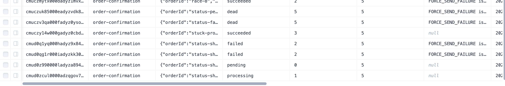
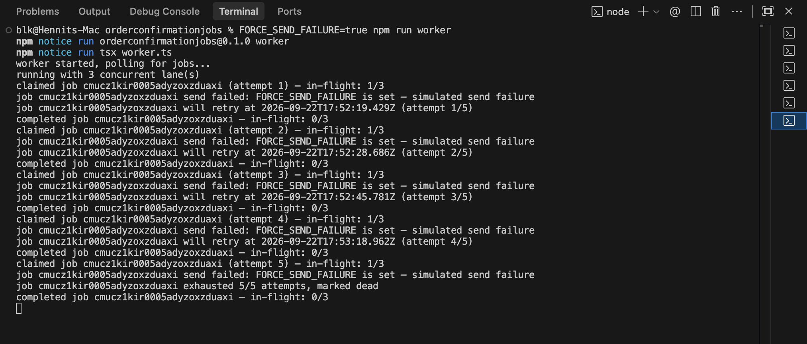
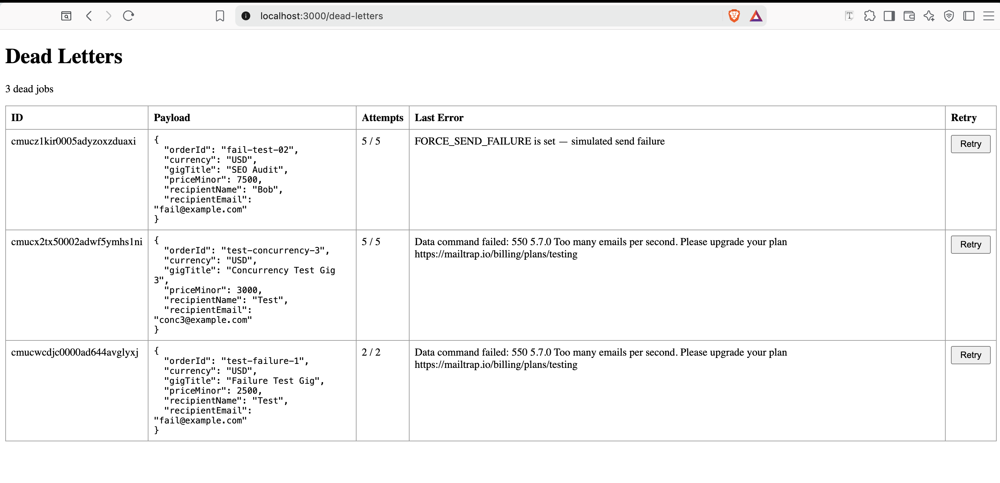
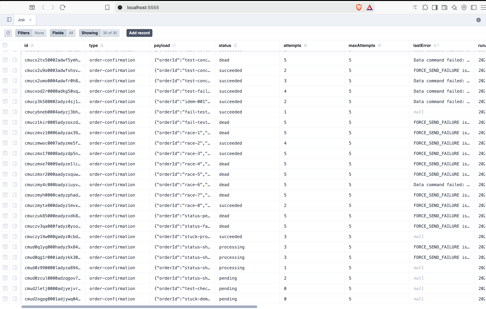
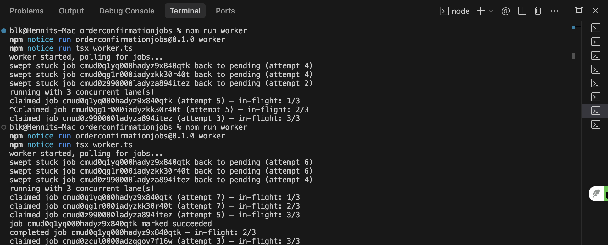
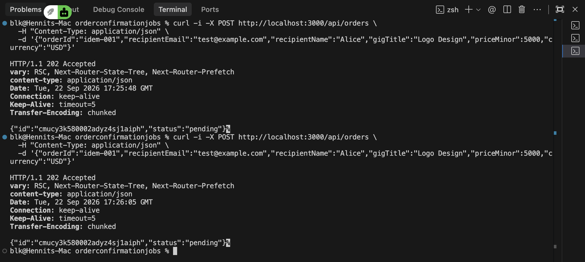
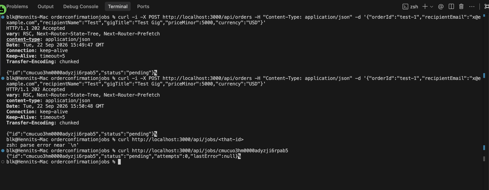
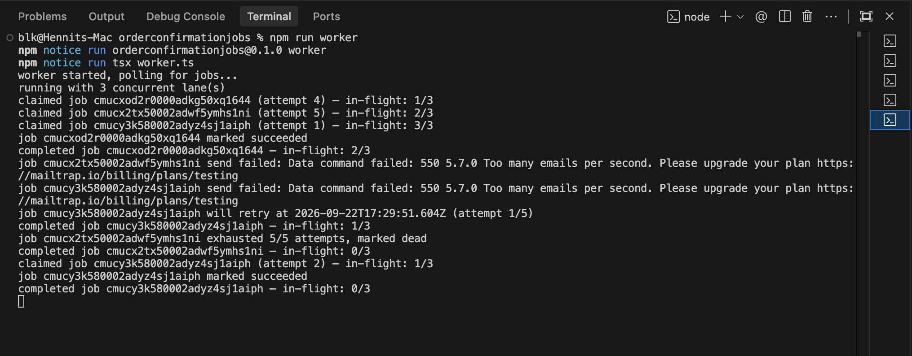

# Order Confirmation Email Jobs

A standalone background job system for one kind of work: sending an order
confirmation email via Nodemailer, over SMTP, through Mailtrap's sandbox.
Next.js API routes handle enqueueing and status lookups; a separate `tsx`
worker script claims and processes jobs. No queue service, no deployment —
everything runs and is verified on localhost.

## Setup

1. `npm install` (also runs `prisma generate`)
2. Copy `.env.example` to `.env` and fill in:
   - `DATABASE_URL`, `DIRECT_URL` — a Neon Postgres project (pooled + direct connection strings)
   - `SMTP_HOST`, `SMTP_PORT`, `SMTP_USER`, `SMTP_PASS` — from your Mailtrap inbox's SMTP Settings page
3. `npx prisma migrate dev` to create the `Job` table

## Running locally

- API: `npm run dev` (Next.js dev server)
- Worker: `npm run worker` (runs `tsx worker.ts`), in its own terminal

Both processes run on localhost only; this project is not deployed.

## Endpoints

- `POST /api/orders` — body `{ orderId, recipientEmail, recipientName, gigTitle, priceMinor, currency }`. Writes a `pending` job and returns `202` with the job id. Idempotent on `orderId` via the `order-confirmation:<orderId>` idempotency key — a repeated `orderId` returns the existing job instead of creating a second one.
- `GET /api/jobs/:id` — returns `{ id, status, attempts, lastError }`.
- `GET /dead-letters` — server-rendered page listing every `dead` job (id, payload, attempts, lastError) with a Retry button per row.
- `POST /api/jobs/:id/retry` — resets a job to `pending`, `attempts: 0`, `lastError: null` (also clears `startedAt`/`finishedAt` and sets `runAt` to now). Backs the Retry button on `/dead-letters`.

## Worker (`worker.ts`)

Runs independently of the API. `MAX_CONCURRENT_JOBS` lanes each loop
claim → process → claim in parallel. The claim is a single atomic
`UPDATE ... FOR UPDATE SKIP LOCKED` statement pulling from jobs with
`status IN ('pending', 'failed')` and `runAt <= now()`.

For each claimed job:
- If `sentAt` is already set, the send is skipped (idempotency guard) and the job is marked `succeeded`.
- Otherwise the email is sent via Nodemailer/Mailtrap. On success, `sentAt` and `status: succeeded` are set together in one update. On failure, `lastError` is recorded and the job is either rescheduled (`status: failed`, exponential backoff + jitter) or marked `dead` once `attempts >= maxAttempts`.

A sweep runs on startup and then every `SWEEP_INTERVAL_MS`, resetting any
job stuck in `processing` past `STUCK_TIMEOUT_MS` back to `pending` with
`attempts` incremented the same as a real failure.

### Config (top of `worker.ts`)

| Constant | Value | Purpose |
|---|---|---|
| `POLL_INTERVAL_MS` | 1000 | Delay between claim attempts when no job is available |
| `BASE_DELAY_MS` | 2000 | Backoff base, paired with `2^attempts` |
| `JITTER_MS` | 1000 | Random jitter added to the backoff delay |
| `STUCK_TIMEOUT_MS` | 60,000 | How long a job may sit in `processing` before being swept |
| `SWEEP_INTERVAL_MS` | 30,000 | How often the stuck-job sweep runs |
| `MAX_CONCURRENT_JOBS` | 3 | Number of parallel claim/process lanes |

`FORCE_SEND_FAILURE=true` (env var) makes every send throw immediately
without contacting Mailtrap — a testing-only switch for exercising the
failure/backoff/dead path on demand, never set in production.

## Evidence

### Every job status in one table view

### Backoff delays growing between attempts

### Dead letter view with a job in it

### Stuck job: after the kill, and after recovery

After the kill — a job left in `processing` with no worker running to
finish it:

After recovery — the startup sweep resetting the stuck job back to
`pending` and the worker successfully reclaiming and completing it:

### Idempotency double-submit

### Status endpoint

### Concurrency

The worker ramping up to its cap (`in-flight: 3/3`), then draining as
jobs complete, retry, or go dead — including real Mailtrap rate-limit
failures handled correctly mid-batch:

*A larger 50-job burst test and a two-worker race screenshot are optional
stretch evidence beyond what AGENTS.md's "concurrency log" requirement
asks for, and are still pending if added later.*

## Design decisions

### Why the atomic claim uses `FOR UPDATE SKIP LOCKED` instead of read-then-write

A read-then-write claim — `SELECT` an eligible job, then `UPDATE` it —
has a race window between the two statements. With multiple lanes (or
multiple worker processes) polling concurrently, two of them could read
the same `pending` row before either has written its `processing` status,
and both would go on to send the same email. Folding the selection and
the status flip into one atomic `UPDATE ... WHERE id = (SELECT ... FOR
UPDATE SKIP LOCKED)` statement closes that window: the row is locked for
the duration of the update, and any other concurrent claim simply skips
rows already locked rather than blocking on them or double-claiming. This
is also what makes it safe to run `MAX_CONCURRENT_JOBS` lanes (or more
worker processes) with no extra coordination between them.

### Why `failed` jobs get their own status distinct from `pending`

`pending` and `failed` are claimed by the same query and treated
identically once `runAt` passes, so mechanically collapsing them into one
status would still work. The reason they're kept separate is that status
is what makes the jobs table legible on its own: a `pending` job with
`attempts: 0` and a `failed` job with `attempts: 3` and a `lastError` are
telling very different stories, and a status column that can't tell them
apart forces anyone reading the table (or building a dashboard on top of
it) to cross-reference `attempts`/`lastError` just to know whether a job
is fresh or already unhealthy. It also matches the project's own
convention that `failed` means "will retry" and `dead` means "exhausted
retries" — quietly reusing `pending` for both "never tried" and "tried
and waiting to retry" would blur exactly the distinction that convention
is meant to preserve.

### Why the idempotency guard checks `sentAt` rather than just the job row existing

The job row's existence (or its status) describes bookkeeping, not the
real-world side effect. A job can legitimately be reprocessed — after the
stuck-job sweep, after a worker crash mid-send, after a manual dead-letter
retry — and in every one of those cases the row alone doesn't say whether
the email actually went out. The worker sends the email first and only
afterward writes `sentAt` + `status: succeeded`; if it crashes in that gap,
the row is left in `processing` (and later swept back to `pending`) even
though the email was genuinely sent. Checking "does a job row exist" or
"has this been attempted" wouldn't catch that case and would send a
second confirmation email. `sentAt` is set only once `sendMail` truly
succeeds, so it's the one field that directly answers "did the side
effect already happen" — which is the actual thing that must not be
duplicated.
